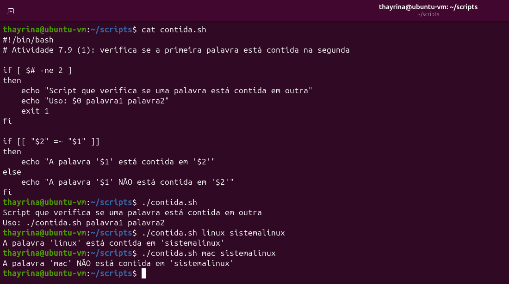
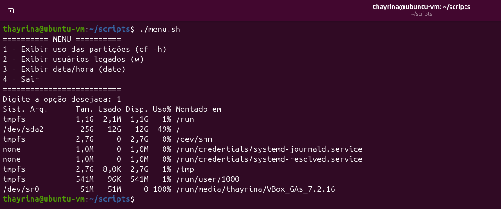

# Conceitos de Sistemas Operacionais e Introdução ao Linux

Trabalho acadêmico da disciplina de **Sistemas Operacionais** do curso de Engenharia de Software da **Universidade Vila Velha (UVV)**, 2026/2, sob orientação do Prof. Jean-Rémi Bourguet.

O trabalho reúne a fundamentação teórica dos principais subsistemas de um sistema operacional e a aplicação prática desses conceitos em GNU/Linux (Ubuntu), com exercícios de *shell* e *shell script* executados em máquina virtual.

**[Ler o trabalho completo (PDF, 65 páginas)](docs/Projeto_Sistemas_Operacionais.pdf)**

---

## Conteúdo

### Parte 1 — Fundamentação teórica

1. Processo de *boot*
2. Gerenciamento de entrada e saída
3. Memória secundária e partições
4. Gerenciamento de arquivos e sistemas de arquivos
5. Grupos, usuários e permissões
6. Gerenciamento de processos
7. Gerenciamento da memória primária, incluindo comparação entre os algoritmos de substituição de páginas FIFO e LRU

### Parte 2 — Prática em Linux

Resolução de exercícios dos capítulos 6 (*Shell*) e 7 (*Shell Script*) do livro *Introdução ao Linux* (Peixoto; Bonfante, 2013), com capturas de tela do terminal e explicação de cada comando.

| Script | Descrição |
|---|---|
| [`contida.sh`](scripts/contida.sh) | Verifica se uma palavra está contida em outra, com validação dos argumentos |
| [`infoarq.sh`](scripts/infoarq.sh) | Exibe a quantidade de caracteres, palavras e linhas de um arquivo, verificando antes se ele existe e pode ser lido |
| [`menu.sh`](scripts/menu.sh) | Menu interativo com `case`: uso das partições (`df -h`), usuários logados (`w`) e data/hora |
| [`agenda.sh`](scripts/agenda.sh) | Busca de contatos em um arquivo de agenda com `grep` |

<p>
  
  
</p>

## Documento

O documento foi escrito em **LaTeX** com a classe **abnTeX2**, seguindo as normas da ABNT. Ele inclui capa, folha de rosto, resumo, lista de siglas, glossário, referências bibliográficas com BibTeX e figuras numeradas. O código-fonte está na pasta [`latex/`](latex).

## Tecnologias


## Estrutura

```
sistemas-operacionais-linux/
├── docs/       trabalho final em PDF e imagens
├── latex/      código-fonte do documento (abnTeX2)
└── scripts/    shell scripts desenvolvidos nas atividades
```

## Equipe

Kaike Alves · Letícia Storch · Mariana Pignaton · Rhayanne Borges · Thayrina Stange

Contribuição de Thayrina Stange: atividades 7.9 e 7.11 (*shell script*), estruturação e montagem do documento em LaTeX/abnTeX2 e revisão final.
